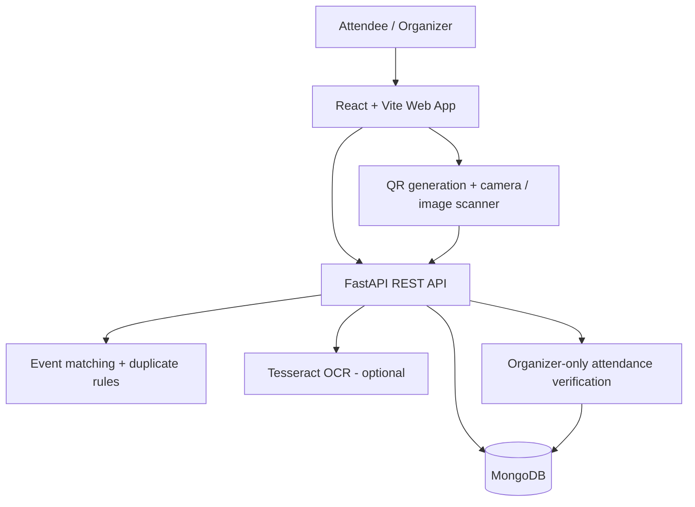

<div align="center">

# 🌐 EventSphere AI

### Discover nearby. Connect smarter.

**VECNAVERSE 2026 | Software Development | Hyperlocal Event Discovery & Community Engagement**

*From a scattered event poster to a discoverable community experience — all in one platform.*

[](client/)
[](server_py/)
[](https://www.mongodb.com/atlas)
[](https://github.com/sujalD2436/Innovex_Prajakta-Bhambar/actions/workflows/ci.yml)

**[Features](#-key-features) · [Architecture](#-system-architecture) · [Run Locally](#-getting-started) · [Live Demo Flow](#-two-minute-hackathon-demo) · [Team](#-team)**

</div>

---

## 🚀 Project Overview

**EventSphere AI** is a full-stack web application designed to help students and local communities discover relevant events, and help organizers move from promotion to measurable participation.

Campus workshops, hackathons, meetups and cultural events are often scattered across posters, social feeds and messaging groups. EventSphere AI brings the journey into a single workflow:

**Poster → Editable OCR Draft → Publish → Discover → Register → QR Ticket → Verified Attendance → Insights**

Built for **VECNAVERSE 2026**, the repository contains a working **hackathon prototype** with a responsive React interface, a FastAPI backend and MongoDB storage. It is suitable for demonstration and further development; it is **not presented as a production-hardened service**.

## 🎯 The Problem & Our Solution

| Today's challenge | EventSphere AI approach |
| --- | --- |
| Event information is fragmented across posters and social channels. | A searchable, category-filtered feed with a nearby event map. |
| Posting event information repeatedly takes organizer time. | Poster OCR prepares an **editable draft**, followed by human review. |
| Students see too many irrelevant announcements. | Explainable matching using interests, distance and upcoming dates. |
| Duplicate event posts create confusion. | Similarity-based warnings before an organizer publishes. |
| Organizers cannot easily measure actual attendance. | Unique QR tickets, organizer-only check-in and participation metrics. |

## ✨ Key Features

| For attendees | For organizers | Platform intelligence |
| --- | --- | --- |
| Sign up and sign in securely | Create and publish event listings | OCR-assisted event field extraction |
| Explore upcoming local events | Check for likely duplicate listings | Rule-based, explainable recommendations |
| Search, filter and explore a map | Scan ticket QR using a camera **or image upload** | Interest, proximity and timing signals |
| Personalize discovery with interests | Manually enter a ticket code when needed | Duplicate title/date/locality scoring |
| Register and view QR tickets | See registrations, verified arrivals and attendance rate | Role-based access and single-use check-ins |

### What makes it different?

Our contribution is the **end-to-end “Poster-to-Participation” workflow**: instead of treating event promotion, discovery, registration and attendance as unrelated tasks, EventSphere AI connects them into a single community-focused experience.

> **A note on “AI”:** Tesseract OCR extracts text from posters, while current event recommendations and duplicate detection are **transparent, rule-based algorithms**. No custom-trained machine-learning model or predictive probability is claimed. OCR results must be reviewed before publishing.

## 🧱 System Architecture



**Data flow:** Users authenticate with JWT; organizers manage events; attendees register and receive 48-character random ticket tokens encoded as QR codes; organizers verify their own tickets through FastAPI. A successful check-in is recorded once, and replay attempts are rejected.

### Technology Stack

| Layer | Technologies |
| --- | --- |
| Frontend | React 19, Vite, JavaScript, Tailwind CSS, Lucide React |
| Map | React Leaflet, Leaflet and public map tiles |
| API | Python 3.11/3.12, FastAPI, Uvicorn, Pydantic |
| Database | MongoDB, PyMongo |
| Authentication | JWT (PyJWT), bcrypt password hashing, attendee/organizer roles |
| QR tickets | `qrcode.react` for generation; `html5-qrcode` for camera/image scanning |
| OCR | Tesseract OCR via `pytesseract` (optional native installation) |
| Quality checks | Pytest, full-stack smoke script, GitHub Actions |
| Deployment design | Vercel (frontend), Render (API), MongoDB Atlas (database) |

## 🗂️ Repository Structure

```text
.
├── client/
│   ├── src/
│   │   ├── App.jsx              # Pages, authentication, tickets and organizer studio
│   │   ├── api.js               # Frontend API client
│   │   └── styles.css           # Application styling
│   └── package.json
├── server_py/
│   ├── app/
│   │   ├── main.py              # FastAPI endpoints
│   │   ├── database.py          # MongoDB connection and indexes
│   │   ├── intelligence.py      # Matching, duplicate rules and OCR parsing
│   │   └── security.py          # JWT and role-based access
│   ├── tests/                   # Python rule-based intelligence tests
│   ├── requirements.txt
│   └── seed.py                  # Local-only fictional demo data
├── docs/
│   ├── API_REFERENCE.md
│   ├── DEMO_AND_PITCH.md
│   └── demo-poster.png
├── scripts/smoke.mjs            # API end-to-end smoke test
├── .github/workflows/ci.yml    # Build and test workflow
├── docker-compose.yml          # Optional local MongoDB
└── package.json                # Root npm workspace commands
```

## ⚡ Getting Started

### Prerequisites

- **Python 3.11 or 3.12**
- **Node.js 22.12+** and npm
- **MongoDB** running locally, through Docker, or accessible in Atlas
- Windows PowerShell commands below; equivalent commands work on macOS/Linux
- Optional: native **Tesseract OCR** for poster extraction

### 1. Clone and install

```powershell
git clone https://github.com/sujalD2436/Innovex_Prajakta-Bhambar.git
cd Innovex_Prajakta-Bhambar
py -3.12 -m venv .venv
.\.venv\Scripts\Activate.ps1
python -m pip install -r server_py\requirements.txt
npm install
```

If Python 3.12 is not installed, create the virtual environment with Python 3.11 instead.

### 2. Configure environment variables

Create **`server_py/.env`** manually with the following keys, replacing the secret placeholder with a randomly generated value:

```dotenv
MONGO_URI=mongodb://127.0.0.1:27017/eventsphere_ai
JWT_SECRET=REPLACE_WITH_A_NEW_RANDOM_SECRET_OF_AT_LEAST_32_CHARACTERS
CLIENT_ORIGIN=http://localhost:5173,http://127.0.0.1:5173
```

Generate a secret with:

```powershell
python -c "import secrets; print(secrets.token_hex(32))"
```

To specify the frontend API explicitly, copy the checked-in frontend example:

```powershell
Copy-Item client\.env.example client\.env
```

Its local value is `VITE_API_URL=http://localhost:5000/api`. **Never commit `.env` files or database credentials.**

### 3. Start MongoDB

Use your local MongoDB Windows service, a MongoDB Atlas URI in `MONGO_URI`, or Docker Desktop:

```powershell
docker compose up -d
```

### 4. Start the application

```powershell
npm run dev
```

| Service | Local URL |
| --- | --- |
| EventSphere AI website | [localhost:5173](http://localhost:5173) |
| FastAPI health endpoint | [localhost:5000/api/health](http://localhost:5000/api/health) |
| Interactive API docs | [localhost:5000/docs](http://localhost:5000/docs) |
| OpenAPI specification | [localhost:5000/openapi.json](http://localhost:5000/openapi.json) |

For a **local-only demo**, you can optionally populate fictional events and shared testing users:

```powershell
npm run seed
```

**Do not run the seed script against a public production database** or publish shared demo accounts. Normal attendee and organizer registration is available through the app.

### Optional — Poster OCR

`pytesseract` is a Python wrapper; it does not install the native Tesseract executable. Install [Tesseract OCR](https://tesseract-ocr.github.io/tessdoc/Installation.html), then verify `tesseract --version` works. If necessary, set the absolute executable path in `server_py/.env`:

```dotenv
TESSERACT_CMD=C:\Program Files\Tesseract-OCR\tesseract.exe
```

Try the example poster at [`docs/demo-poster.png`](docs/demo-poster.png). Treat OCR text and extracted date/time/venue as suggestions until a person reviews them.

## 🧪 Testing & Quality

```powershell
npm test           # Offline Python rules/tests
npm run build      # Production frontend build
npm run smoke      # Full-stack API smoke test (requires running API + seeded data)
```

The smoke test exercises organizer publishing, attendee registration, ticket creation, role enforcement, one-time check-in and replay prevention. **It inserts test records into the connected database**; run it against a dedicated local or test database, not production.

GitHub Actions runs Python tests and the React production build on pushes and pull requests. See the [CI workflow](.github/workflows/ci.yml).

## 🎬 Two-Minute Hackathon Demo

1. **Discover:** Find a local workshop or hackathon from the event feed and map.
2. **Create:** As an organizer, upload the [sample poster](docs/demo-poster.png), review the OCR draft and publish an event.
3. **Recommend:** Show how interests, distance and date influence event ranking.
4. **Register:** As an attendee, register and open **My Tickets** to display the QR code.
5. **Check in:** Return as the event organizer and scan the QR using a camera, upload a QR image, or paste the ticket token.
6. **Measure:** Show verified attendance on the organizer dashboard, and demonstrate that a second check-in is rejected.

See the [full demo script and judge Q&A](docs/DEMO_AND_PITCH.md) and [API reference](docs/API_REFERENCE.md).

## ☁️ Deployment Configuration

The frontend and backend are deployed as separate services. **Do not assume a live deployment exists until the actual service URLs and health checks have been verified.**

| Platform | Source / setting | Required configuration |
| --- | --- | --- |
| **Vercel** | GitHub `main`, root directory `client`, Vite build, output `dist` | `VITE_API_URL=https://YOUR-RENDER-SERVICE.onrender.com/api` |
| **Render** | GitHub `main`, root directory `server_py` | Build: `pip install -r requirements.txt`; start: `uvicorn app.main:app --host 0.0.0.0 --port $PORT` |
| **MongoDB Atlas** | Cloud MongoDB cluster | Dedicated database user, database URI, allowed Render outbound IP ranges |

Set `MONGO_URI`, a new `JWT_SECRET` (at least 32 characters) and `CLIENT_ORIGIN=https://YOUR-VERCEL-DOMAIN` in **Render's private environment configuration**. A Render deployment without the native Tesseract binary can still support manual event creation, but **poster OCR requires installing that binary separately**.

## 🔒 Scope, Security & Responsible Claims

This is a completed **hackathon MVP codebase**, not a certified production deployment. Current boundaries include:

- Recommendations and duplicate detection are explainable rules; they are not trained AI prediction models.
- OCR can misread details and requires manual confirmation.
- Attendee/organizer roles are enforced, but organizers are not identity-verified or moderated.
- JWT is kept in browser `localStorage`; production should use hardened sessions and additional protections.
- Event capacity updates are not transactionally protected against highly concurrent registration.
- QR codes carry unique random tokens, but attendance relies on a working backend and MongoDB connection.
- This system does not currently process payments or guarantee event authenticity.

Future work includes verified organizer onboarding, moderation, stronger account recovery and session security, reliable high-volume ticket inventory controls, and semantic multilingual recommendations.

## 👥 Team

**VECNAVERSE 2026 — EventSphere AI**

- **Prajakta Bhambar**
- **Sujal Das**
- **Namita Geete**
- **Rajendra Vishnoi**

---

<div align="center">

**Built for the VECNAVERSE 2026 hackathon.**  
*Discover opportunities. Build communities. Measure participation.*

</div>
